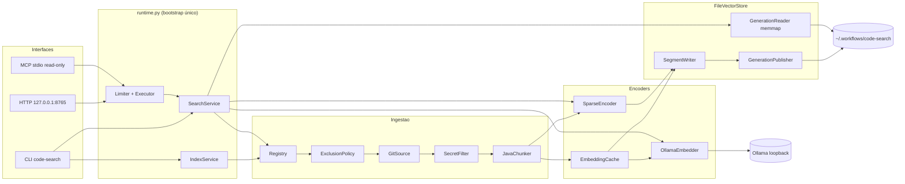
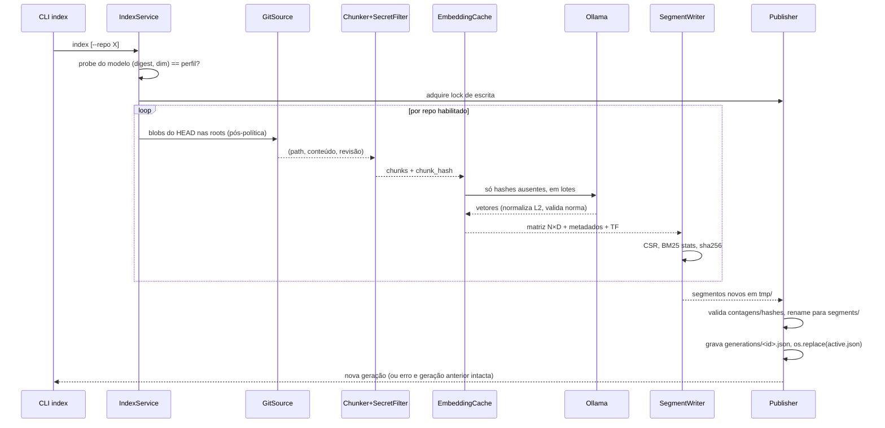

# Code Search híbrido: revisão da spec e desenho de solução (com NumPy)

Data: 2026-10-17 · Base: "Prompt 2 — orquestrador-code-search-embeddings-unificado" e o plano de 4 fases postado no projeto.
Premissa nova: **NumPy passa a ser permitido** (única dependência externa; demais restrições mantidas: zero egress, monousuário, 127.0.0.1:8765, sem banco).

---

## 1. Resumo

A spec é sólida nos pontos difíceis (fail-closed, gerações imutáveis, perfil de embedding, gate de avaliação). Os principais problemas são:

1. **Duas contradições internas**: "reindex = full rebuild" contra "conteúdo inalterado não regenera embedding"; e "score lexical sobre o JSONL" contra a exigência de latência e concorrência.
2. **Lacunas de definição**: o chunker não diz como extrai `symbol`/`parent_symbol`; o encoder esparso não define pesos (TF? BM25? IDF de onde?); o perfil não cobre versão do chunker e do tokenizador, que também invalidam o índice.
3. **O plano está ordenado por camada, não por risco**: o gate de avaliação, que a spec exige *antes* do primeiro índice real, ficou na última fase; e não há uma fatia E2E cedo.

Com NumPy, a arquitetura recomendada é: **segmentos imutáveis por repositório** (matriz densa `.npy` memmapped, já normalizada; índice invertido em CSR para o lexical; colunas de metadados em arrays) agrupados por **gerações** publicadas atomicamente via `active.json`, mais um **cache de embeddings por `(profile_id, chunk_hash)`** que torna o full rebuild barato.

---

## 2. Pontos a melhorar na spec

Ordenados por impacto. Cada item diz o problema e a proposta.

### 2.1 Armazenamento e índice

| # | Problema | Proposta |
|---|----------|----------|
| A1 | `vectors.bin` cru exige validar dtype/shape à mão. | Usar `dense.npy` (float32, C-order) aberto com `np.load(..., mmap_mode="r")`; o header valida dtype e shape. Manifest guarda `sha256`, `shape`, `dtype`. |
| A2 | Vetores não são normalizados na ingestão, então cada busca recalcula normas. | Normalizar L2 no build; cosseno vira `M @ q`. Validar no probe que o modelo devolve norma > 0 e rejeitar vetor com norma ~0 (`embedder_invalid_output`). |
| A3 | "Score lexical sobre o JSONL" significa parsear todo o JSONL a cada consulta: O(N) em Python, com GIL. | Construir **índice invertido em CSR** no build (`vocab.json`, `postings_offsets.npy`, `postings_doc.npy`, `postings_tf.npy`, `doc_len.npy`) e pontuar com **BM25** vetorizado. O JSONL fica só para payload. |
| A4 | Ler o texto do resultado no JSONL exige varrer o arquivo. | `chunks.offsets.npy` (uint64) com o byte offset de cada linha; leitura O(1) com `seek`. |
| A5 | Filtros por metadados (repo, linguagem, `path_prefix`) não têm estrutura. | Colunas em arrays: `repo_idx`, `lang_idx`, `source_idx`, `start_line`, `end_line`. Filtro vira máscara booleana. `path_prefix` é resolvido contra a lista de `sources` por **componentes** (`PurePosixPath.parts`), nunca `startswith`, gerando um conjunto de `source_idx`. |
| A6 | Geração única com todos os repos: falha ou mudança em um repo força reprocessar e republicar tudo. | **Segmentos por repo** (imutáveis, endereçados por hash). A geração é um manifesto que lista segmentos. Reindexar um repo cria um segmento novo e uma geração nova que reaproveita os demais. Mantém full rebuild como modo padrão, mas permite `index --repo X`. |
| A7 | Prune pode apagar uma geração que um leitor ainda tem em memmap. | No Linux/macOS o arquivo apagado continua válido para quem já abriu; mesmo assim, prune só remove o que não é `active`, nem `previous`, e tem mais de N minutos. Segmentos são coletados por referência (GC). Documentar que no Windows isso não vale. |

### 2.2 Identidade, cache e perfil

| # | Problema | Proposta |
|---|----------|----------|
| B1 | Contradição: full rebuild sempre, mas "conteúdo inalterado não regenera embedding". | **Cache de embeddings** separado das gerações: `cache/<profile_id>/` com shards `keys.npy` (hash 16 bytes) + `vecs.npy`. O rebuild recria o segmento, mas só chama o Ollama para `chunk_hash` ausentes. |
| B2 | ID `UUIDv5(profile_id+repo_id+source+symbol_path+chunk_hash)` colide se o mesmo trecho aparece duas vezes no mesmo símbolo (janelas repetidas, código gerado). | Incluir `start_line` (ou índice da janela) no ID. O cache continua chaveado só por `chunk_hash`, então o reaproveitamento não muda. |
| B3 | O perfil cobre só o embedder, mas chunker, tokenizador esparso e parâmetros BM25 também mudam o índice. | Separar **`embedding_profile`** (modelo, digest, dimensão, métrica, prefixos, normalização) de **`index_schema`** (versão do chunker, do tokenizador, da política de exclusão, k1/b do BM25). Compatibilidade de busca exige ambos. O gate é refeito quando qualquer um muda. |
| B4 | "Revisão" do modelo é ambígua no Ollama (tags são mutáveis). | Usar o **digest** retornado por `/api/show` (ou `/api/tags`). No `serve`, o probe compara o digest atual com o do perfil ativo; divergência = `profile_mismatch` e `/ready` falso. |

### 2.3 Ingestão

| # | Problema | Proposta |
|---|----------|----------|
| C1 | Não diz como ler "arquivos rastreados no HEAD". Ler o working tree mistura alterações locais e quebra a semântica de `repo_revision`. | Ler blobs direto do Git: `git ls-tree -r -z HEAD -- <root>` e `git cat-file --batch`. O índice corresponde exatamente ao commit. Symlinks aparecem como modo `120000` e são descartados sem seguir. |
| C2 | Chunker por janelas de linhas não produz `symbol`/`parent_symbol`, que estão na resposta. | Scanner Java leve (stdlib): tokeniza ignorando strings, chars e comentários, acompanha chaves e reconhece `package`, tipos (class/interface/enum/record) e métodos/construtores. Estratégia: **um chunk por método** se couber em 80 linhas/6000 chars; senão, janelas com overlap 10 dentro do método; código fora de métodos (campos, imports) em chunks de "corpo da classe". Javadoc vai junto com o método. |
| C3 | 6000 chars podem passar do contexto do modelo; o Ollama trunca silenciosamente por padrão. | Enviar `truncate: false` no `/api/embed` para receber erro, e definir `max_input_tokens` no perfil (medido no probe). Chunk que estoura é subdividido, nunca truncado em silêncio. |
| C4 | O pré-filtro de segredos não define o que fazer quando detecta. | Política explícita: descartar o **chunk** (não o arquivo inteiro), contar em `skipped_secrets` no manifest, sem logar o conteúdo. Regras versionadas junto com a política de exclusão. |
| C5 | `repositories.json` não diz como o repo é identificado. | `repo_id` estável (slug escolhido pelo usuário), `path` absoluto só no registro local, nunca exposto na API. Validar que `roots` está dentro do repo por `resolve()` + `relative_to`. |

### 2.4 Busca e runtime

| # | Problema | Proposta |
|---|----------|----------|
| D1 | RRF sem parâmetros. | Fixar `k=60`, profundidade de candidatos `depth=max(100, 5*top_k)` por sinal, desempate determinístico por `(source, start_line)`. Parâmetros entram no `index_schema` ou na config de busca registrada no gate. |
| D2 | Colapso de chunks sobrepostos sem regra. | Mesmo `source` e intervalos que se sobrepõem: manter o de maior score fundido e estender `start_line/end_line` só se o usuário pedir contexto. Colapsar **antes** de cortar em `top_k`. |
| D3 | Timeout por requisição em executor não cancela a thread. | Aceitar isso explicitamente: o 504 libera o cliente, mas o slot do semáforo só é liberado quando a tarefa termina. Por isso o limite de concorrência precisa contar tarefas em execução, não requisições abertas. Embedding da query tem timeout próprio no cliente HTTP do Ollama. |
| D4 | `/ready` "modelo carregado": o Ollama descarrega o modelo após `keep_alive`. | `/ready` verifica Ollama alcançável + modelo presente com o digest esperado + `active.json` íntegro. Warm-up no `serve` e `keep_alive` configurável; a primeira query fria entra no p95 medido no gate. |
| D5 | `status: partial` sem definição exata. | `partial` quando ao menos um repo pedido está `sem índice`, `desconhecido` ou com segmento inválido, e ao menos um foi buscado. Nenhum buscado = `no_repos_available` 404. |
| D6 | MCP stdio sem versão de protocolo. | Implementar JSON-RPC 2.0 manualmente (sem SDK) e fixar a versão de protocolo MCP suportada; limitar o tamanho do `text` devolvido por resultado. |

### 2.5 Qualidade e gate

| # | Problema | Proposta |
|---|----------|----------|
| E1 | O gate não define tamanho do dataset nem baseline. | Mínimo de ~30 consultas por UC (90 no total), rotuladas com o(s) chunk(s) relevante(s) por `source + intervalo`. Comparar sempre contra o **baseline lexical puro**: a busca híbrida só se justifica se ganhar dele em UC1/UC3 sem perder em UC2. |
| E2 | Limiares "definidos antes" sem exemplo. | Registrar em `eval/thresholds.json`, versionado, antes de rodar. Ponto de partida a calibrar: UC2 Recall@5 ≥ 0,95; UC1 nDCG@10 ≥ baseline + 0,10; p95 ≤ 300 ms com cache quente. |
| E3 | "Nenhuma chamada externa (verificado por teste)" sem mecanismo. | Fixture pytest que substitui `socket.socket.connect` e falha para qualquer destino diferente de 127.0.0.1/::1; roda em toda a suíte. Validar também que `CODE_SEARCH_OLLAMA_URL` só aceita loopback. |

---

## 3. Pontos a melhorar no plano

1. **Ordenar por risco, com uma fatia E2E cedo.** Uma busca ponta a ponta com embedder falso sobre 2 repos de fixture deve existir ao fim da fase 2, não da 3.
2. **Trazer o gate para antes do índice real.** O harness de avaliação (métricas, dataset, limiares) é construído junto com a busca; a indexação real só acontece depois de o gate passar.
3. **Fase 0 de fundação.** Repositório Git, `pyproject` com NumPy fixado, contratos, fakes, teste de zero egress e CI rodando pytest. Hoje a fase 1 mistura isso com o storage.
4. **Critério de pronto por fase.** Cada fase termina com testes nomeados e verdes, não só com componentes escritos.
5. **Código em repositório Git, não na pasta do projeto.** A pasta de arquivos do projeto não dá histórico, PR nem CI. Recomendo criar um repo (privado) e conectá-lo ao projeto.

---

## 4. Arquitetura de solução

### 4.1 Componentes



Responsabilidade de cada um:

| Componente | Faz | Não faz |
|---|---|---|
| `Registry` | CRUD de `repositories.json`, resolve repo → disponível/sem índice/desconhecido. | Ler arquivos. |
| `ExclusionPolicy` | Carrega e valida política versionada; ausente/inválida = conjunto vazio. Decide por componentes de caminho. | Abrir arquivos. |
| `GitSource` | Lista blobs do HEAD nas roots e lê conteúdo via `git cat-file --batch`. | Ler o working tree. |
| `SecretFilter` | Heurísticas (chaves PEM, tokens, `password=`), descarta chunk e conta. | Ser um scanner completo. |
| `JavaChunker` | Símbolos e janelas, cabeçalho repo/caminho/classe/linhas. | Embedar. |
| `EmbeddingCache` | Busca vetores por `(profile_id, chunk_hash)`, envia só os ausentes ao embedder em lotes. | Ranking. |
| `OllamaEmbedder` | `/api/embed` em loopback, prefixos de instrução, `truncate:false`, erro `embedder_unavailable`. | Retornar vetor zero. |
| `SparseEncoder` | Tokeniza identificadores (camelCase, snake_case, dígitos, minúsculas, mantém o token inteiro também) e devolve TF. | Calcular IDF (isso é do segmento). |
| `SegmentWriter` | Monta um segmento de um repo em diretório temporário e calcula hashes. | Publicar. |
| `GenerationPublisher` | Lock, valida, `rename`, `os.replace(active.json)`, mantém `previous`. | Apagar sem `prune` explícito. |
| `GenerationReader` | Abre `active.json` uma vez por requisição, memmap dos segmentos, cache LRU de readers por `generation_id`. | Escrever. |
| `SearchService` | Valida, resolve repos, checa perfil, embeda query, filtra, pontua, funde, colapsa, monta resposta. | Saber de HTTP/CLI. |

### 4.2 Fluxo de indexação



Qualquer exceção antes do `os.replace` deixa `active.json` intocado; os diretórios temporários são limpos no próximo `index`.

### 4.3 Fluxo de busca

1. **Validar** query (tamanho máx.), `top_k` (máx.), número de repos, `mode`.
2. **Resolver repos** no registro e ler `active.json` (uma leitura, sem lock). Repos sem segmento vão para `coverage.unavailable`.
3. **Compatibilidade**: `embedding_profile` e `index_schema` ativos == runtime; senão `profile_mismatch` 409.
4. **Codificar**: `embed_query` (modo semantic/hybrid) e `encode_query` (lexical/hybrid). Falha do embedder no modo hybrid = 503, sem cair silenciosamente para lexical (fail-closed; um fallback explícito pode ser opção futura com `status: partial`).
5. **Por segmento** (um por repo buscado):
   - máscara de filtros: `mask = isin(lang_idx, L) & isin(source_idx, S)`;
   - denso: `scores = dense[mask_idx] @ q` → `argpartition` para `depth`;
   - lexical: para cada termo da query, fatia de postings, `np.add.at(scores, docs, bm25(tf, idf, doc_len))`, aplica máscara, `argpartition`.
6. **Fusão RRF** global sobre os rankings de todos os segmentos: `1/(k + rank_denso) + 1/(k + rank_lexical)`.
7. **Colapso** de sobreposições por `source`, depois corte em `top_k`.
8. **Hidratar** texto via `chunks.offsets.npy` e montar a resposta com `repo_revision` e `indexed_at` do segmento.

Custo esperado: 200 mil chunks × 768 dim em float32 ≈ 590 MB em disco e uma multiplicação matriz-vetor de ~150 M flops por consulta, na casa de dezenas de ms em CPU. Busca exata é suficiente até ~1–2 milhões de chunks; acima disso, avaliar float16 no disco (metade do tamanho) antes de pensar em ANN.

### 4.4 Layout em disco

```
~/.workflows/code-search/
├── config.json                  # URL do Ollama (só loopback), limites, keep_alive
├── repositories.json            # repo_id, path, ref=HEAD, roots, enabled
├── exclusion-policy.json        # versão + regras; ausente/inválida = indexa nada
├── active.json                  # {"generation": "<id>", "manifest_sha256": "..."}
├── previous.json                # geração anterior (rollback = trocar ponteiro)
├── write.lock                   # lock cross-process (fcntl.flock)
├── cache/
│   └── <profile_id>/
│       ├── shard-0001.keys.npy  # (n, 16) uint8: chunk_hash
│       └── shard-0001.vecs.npy  # (n, D) float32 normalizado
├── generations/
│   └── <generation_id>.json     # perfil, index_schema, lista de segmentos + sha256
├── segments/
│   └── <segment_id>/            # um por (repo, revisão, perfil, schema); imutável
│       ├── manifest.json        # repo_id, repo_revision, indexed_at, contagens, hashes
│       ├── dense.npy            # (N, D) float32, L2-normalizado
│       ├── ids.npy              # (N, 16) uint8: UUIDv5
│       ├── meta/
│       │   ├── source_idx.npy   # int32 → sources.json
│       │   ├── lang_idx.npy     # uint8
│       │   ├── start_line.npy   # int32
│       │   └── end_line.npy     # int32
│       ├── sources.json         # caminhos relativos ao repo
│       ├── symbols.json         # symbol / parent_symbol por chunk
│       ├── chunks.jsonl         # texto + payload
│       ├── chunks.offsets.npy   # uint64
│       └── lexical/
│           ├── vocab.json       # termo → term_id
│           ├── df.npy           # int32 por termo
│           ├── postings_offsets.npy  # int64, tamanho V+1 (CSR)
│           ├── postings_doc.npy      # int32
│           ├── postings_tf.npy       # float32
│           ├── doc_len.npy           # int32
│           └── stats.json            # N, avgdl, k1, b
└── tmp/                         # mesmo volume; staging antes do rename
```

O IDF é por segmento (por repo). Para RRF isso é aceitável, porque a fusão usa só posições. Se o gate mostrar distorção entre repos, calcular um IDF global da geração no momento da publicação.

### 4.5 Contratos (resumo)

```text
EmbeddingProfile: model, digest, dim, metric="cosine", normalized=True,
                  doc_prefix, query_prefix, max_input_tokens → profile_id = sha256(canônico)
IndexSchema:      chunker_version, tokenizer_version, policy_version, bm25{k1,b} → schema_id

Embedder.profile
Embedder.embed_documents(texts) -> ndarray (n, dim) float32
Embedder.embed_query(text)      -> ndarray (dim,)  float32

SparseEncoder.encode_documents(texts) -> list[(term_ids, tf)]
SparseEncoder.encode_query(text)      -> (term_ids, weights)

VectorStore.publish(segments, profile, schema) -> generation_id
VectorStore.open_active() -> GenerationSnapshot
GenerationSnapshot.search(repos, dense_q, sparse_q, filters, mode, depth) -> rankings
GenerationSnapshot.profile / .schema / .coverage(repos)
VectorStore.rollback() / .prune(keep=N)
```

Mudança em relação à spec: o store expõe **snapshot** (lido uma vez por requisição) em vez de `search` direto. Isso garante que toda a requisição veja a mesma geração, mesmo se uma publicação acontecer no meio.

### 4.6 Estrutura de código

```
src/workflows/apps/code_search/
├── api/server.py        # ThreadingHTTPServer, rotas, mapeamento de erros
├── cli.py
├── mcp_server.py        # JSON-RPC stdio, read-only
├── runtime.py           # bootstrap: injeta embedder, store, registro, limites
├── config.py
├── core.py              # contratos, tipos, erros
├── registry.py
├── policy.py            # novo: política de exclusão + filtro de segredos
├── git_source.py        # novo: leitura do HEAD
├── chunker.py           # novo: scanner Java
├── sparse.py            # novo: tokenizador + BM25
├── fusion.py            # novo: RRF + colapso
├── embedding_cache.py   # novo
├── ollama_embedder.py
├── file_store.py        # segmentos, gerações, publisher, reader
├── indexer.py
└── search.py            # novo: SearchService (sai de core.py)
eval/
├── datasets/uc1.jsonl uc2.jsonl uc3.jsonl
├── thresholds.json      # versionado antes da rodada
└── run_eval.py          # Recall@k, MRR, nDCG, p50/p95
tests/
```

---

## 5. Plano revisado

| Fase | Entrega | Pronto quando |
|---|---|---|
| **0. Fundação** | Repo Git, `pyproject` (Python 3.12, NumPy fixado), `core.py` com contratos e erros, fakes determinísticos não nulos, fixture de zero egress, CI com pytest. | CI verde; teste de egress falha se alguém abrir socket externo. |
| **1. Armazenamento** | `SegmentWriter`, `GenerationPublisher`, `GenerationReader` memmap, lock, rollback, prune. | Gravar/reabrir/buscar/remover; falha antes e depois do rename preserva a geração; leitores concorrentes durante publicação sempre veem geração íntegra. |
| **2. Ingestão + fatia E2E** | Registro, política, `GitSource`, chunker Java, filtro de segredos, `SparseEncoder`, cache de embeddings, `IndexService`; `SearchService` mínimo. | E2E com 2 repos Git de fixture e embedder falso: indexa e busca nos dois. Testes de symlink, `repo` vs `repo-old`, política ausente. |
| **3. Busca completa + interfaces + harness de avaliação** | RRF, colapso, cobertura, limites, executor, logs estruturados; CLI, HTTP, MCP; `eval/` com métricas e latência. | Contrato HTTP completo testado (todos os códigos de erro); MCP sem escrita; harness roda contra fakes. |
| **4. Ollama + gate** | `OllamaEmbedder`, `ollama-probe`, warm-up; dataset rotulado UC1/UC2/UC3; limiares registrados; comparação hybrid × lexical × semantic. | Gate aprovado com os limiares já versionados. Só então o primeiro índice real. |
| **5. Operação** | `status`, `rollback`, `prune`, reindex por repo, endurecimento de mensagens de erro. | Aceite da spec: suíte verde, E2E real em 2 repos, falha de embedding preserva geração ativa. |

---

## 6. Decisões em aberto para o Luan

1. **Onde fica o código**: recomendo um repositório GitHub privado conectado ao projeto (histórico, PRs, CI), em vez da pasta de arquivos do projeto.
2. **Modelo de embedding** para o gate: escolher 2 candidatos disponíveis no seu Ollama (um genérico e um focado em código) para comparar; o gate decide.
3. **Tamanho do corpus**: número aproximado de repos e de arquivos Java, para confirmar que busca exata em float32 basta.
4. **Sistema operacional**: a semântica de `os.replace`, `flock` e arquivos abertos durante prune assume Linux/macOS; Windows exigiria ajustes.

---

## 7. Como atualizar o índice quando um repositório muda

"Imutável" vale para cada segmento depois de publicado: nada é editado no lugar. A atualização cria um **segmento novo** e troca o ponteiro.

1. `code-search index --repo X` lê o HEAD atual do repo e compara com a `repo_revision` do segmento ativo. Se for igual, não faz nada.
2. Se mudou, o chunker gera os chunks de novo. Cada chunk tem `chunk_hash`; o `EmbeddingCache` devolve na hora os vetores dos chunks que não mudaram e só os chunks novos ou alterados vão ao Ollama. Uma mudança pequena custa poucos embeddings.
3. O `SegmentWriter` monta o segmento novo do repo X em `tmp/` (matriz densa, índice lexical, metadados) e valida hashes e contagens.
4. O `Publisher` cria uma **geração nova** que lista o segmento novo de X e os segmentos antigos dos outros repos (reaproveitados sem copiar) e faz `os.replace` do `active.json`.
5. Quem estava buscando termina na geração antiga; as próximas buscas já veem a nova. A geração e o segmento antigos viram o `previous` (rollback) e só somem em `prune` explícito.

Custos e limites:
- O segmento do repo é reconstruído inteiro (a matriz é recopiada do cache). Para o tamanho esperado isso leva segundos; atualização incremental dentro do segmento fica fora do escopo.
- Mudou o modelo, o prefixo, o chunker ou o tokenizador: o cache do perfil antigo não vale, então é reindexação completa em geração nova, passando pelo gate antes de trocar o `active.json`.
- Gatilho: manual (`index`) na primeira versão. Opcional depois: hook `post-commit`/`post-merge` ou um timer que chama `index` para repos cujo HEAD mudou.
